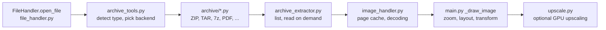

# Contributing

Bug reports, ideas and pull requests are welcome in the
[issue tracker](https://github.com/yu45020/mcomix/issues). The maintainer
decides scope and user-visible behavior, so for anything larger than a bug fix,
open an issue to agree on the change first.

## Set up (Windows)

MComix is developed on Windows in a conda-forge environment kept in `.venv`
(a conda prefix, not a stdlib venv). Install
[Miniforge](https://github.com/conda-forge/miniforge), then from the
repository root:

```powershell
mamba env create -p ./.venv -f environment.yml
.\start.bat
```

[environment.yml](environment.yml) explains the channel rule and the commands
to refresh the environment. The Environment section of [AGENTS.md](AGENTS.md)
lists which packages come from pip, and gives the clean PowerShell environment
for running any other Python command (MSYS2's GTK on `PATH` breaks
PyGObject). While testing, set `APPDATA` to a scratch folder so your own
preferences and library are left alone.

## Check your change

```powershell
.venv\python.exe tools/check.py            # lint and the whole test suite (about a minute)
.venv\python.exe tools/check.py --quick    # lint only
.venv\python.exe tools/check.py --tests test/test_archives.py -k zip
```

Lint is pyflakes on `mcomix` and `test`. Any test failure is a regression.
Tests that need 7-Zip, PyMuPDF, ONNX Runtime or torch skip when those are
missing; `check.py` finds 7-Zip in `C:\Program Files`. The tests cover little
of the UI, so run the app and look at what you changed.

## Find your way around

[AGENTS.md](AGENTS.md) has the code map: the main flows, a table from each
feature to its files, and recipes for a new setting, a new shortcut or a new
archive format. In short:



- [docs/requirements/](docs/requirements/README.md) lists the behavior each
  of the fork's features must keep. A change to a listed behavior updates that
  file.
- [docs/user/](docs/user/README.md) is the user guide. Update it when you
  change what users see.
- [win32/README.md](win32/README.md) covers the portable Windows build;
  [docs/agents/upscale-tooling.md](docs/agents/upscale-tooling.md) covers
  exporting and benchmarking upscaling models.

## Conventions

The Conventions section of [AGENTS.md](AGENTS.md), and its Comments and
Simplicity rules, apply to every change, by people and agents alike: GTK 3
only, user-visible strings in `_()`, small direct changes, and comments that
explain why. In addition:

- A bug fix comes with a test that fails without it; see
  [docs/agents/tests.md](docs/agents/tests.md).
- One logical change per commit, with a short imperative subject.
- Upstream changes aren't merged in. Fixes from upstream are cherry-picked
  one at a time.

## Coding agents

This repository is also worked on with coding agents, and ships the
maintainer's setup for Claude Code and Codex: [AGENTS.md](AGENTS.md) holds the
shared rules, and `CLAUDE.md`, `.claude/`, `.agents/` and `.codex/` adapt them
to each tool. [Working with coding agents](docs/coding-agents.md) explains
what each file does and how to use the workflows. Contributors who don't use
agents can ignore them, but the conventions and checks above apply to everyone.
