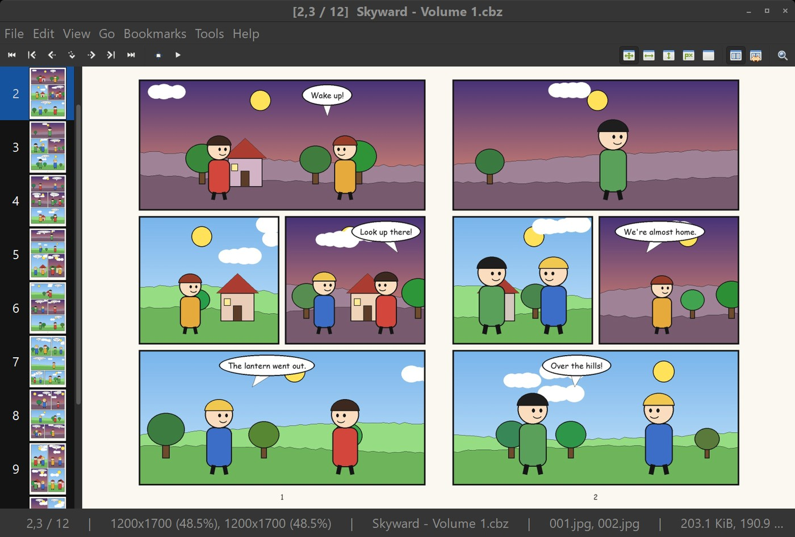
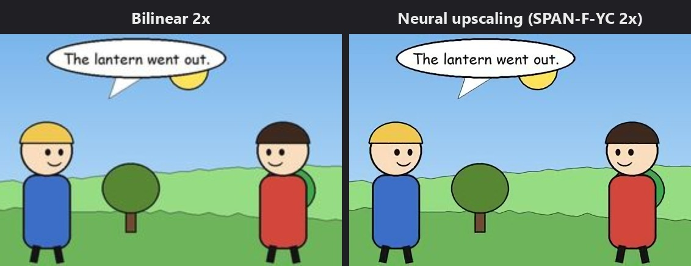
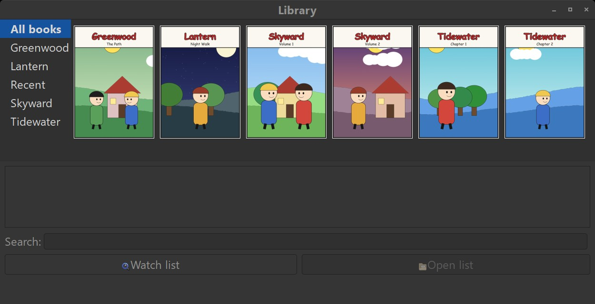

<p align="center">
  
</p>

<h1 align="center">MComix</h1>

<p align="center">
  A fast, keyboard-friendly comic book and manga viewer for Windows, with
  optional GPU neural upscaling.<br>
  A hard fork of <a href="https://sourceforge.net/projects/mcomix/">MComix</a>.
</p>



MComix reads comic archives (CBZ, CBR, CB7, CBT), PDF, MobiPocket and folders
of images, with fit modes, double page and manga (right-to-left) reading, smart
scrolling, bookmarks and a cover library. It is written in Python with GTK 3.

## What this fork adds

- **Neural upscaling of small pages.** A bundled SPAN-F-YC 2x model, trained
  for this fork, enlarges low-resolution scans on the GPU, through DirectML or
  NVIDIA TensorRT-RTX via Windows ML. Pages show at once and sharpen when the
  result is ready. On downscaled test pages it scores 3.5–5.7 dB PSNR-Y above
  Lanczos ([benchmark](docs/user/README.md#benchmark)). It never runs on the
  CPU, and you can use your own ONNX models.
- **Animated WebP playback**, from files and archives, with the file's own
  frame timing, in every zoom mode and in double page mode.
- **Pages read on demand.** ZIP, uncompressed TAR and non-solid RAR/7z books
  open at once, without extracting the whole archive to a temporary folder.
- **More formats:** AVIF and SVG pages, and correct Japanese (Shift JIS) file
  names in ZIPs. ZIPs with BZIP2/LZMA compression open without 7-Zip.
- **Open at a page:** `--entry NAME` and `--page N` open a book at a chosen
  page, so a manga manager or a script can hand books to MComix.
- **Shift pairing** in the View menu (Ctrl+Page Down / Ctrl+Page Up) fixes
  double page spreads in books with a missing page.
- **Lanczos scaling** for sharper downscaled pages.
- **A portable Windows build:** extract a folder and run it, with no installer
  and no MSYS2.
- **Safer settings:** preferences, bookmarks and shortcuts are written
  atomically, and a damaged file is kept aside instead of being overwritten.
- **About a hundred bug fixes** in archive handling, the library,
  bookmarks, shortcuts and responsiveness while pages load.

See [ChangeLog.md](ChangeLog.md) for the full list.

| Neural upscaling | Library |
| --- | --- |
|  |  |

## Get it

Releases contain one download: a portable build for 64-bit Windows.

1. Download `mcomix-win64-<version>.zip` from
   [Releases](https://github.com/yu45020/mcomix/releases).
2. Extract it to a folder of your choice, for example
   `C:\Tools\MComix`. Keep the whole folder together.
3. Run `MComix.exe`. No installation or administrator access is needed.

Settings, the library and GPU caches are stored in `%APPDATA%\MComix`, not in
the program folder, so you can replace the folder with a newer release without
losing them.

Opening 7z, RAR and LHA archives needs [7-Zip](https://www.7-zip.org/)
installed, or `7z.exe` next to `MComix.exe`. Neural upscaling needs a
DirectX 12 GPU.

The `mcomix` packages in winget, Chocolatey, Scoop, Flathub and Linux
distributions are upstream MComix, not this fork. To run this fork from
source, see [Installation](docs/user/installation.md).

### Add MComix to the right-click menu

This adds an **Open with MComix** entry when you right-click a file, a folder,
or the empty space inside a folder. It changes only your own user account and
needs no administrator access.

1. Open the extracted MComix folder in File Explorer.
2. Right-click empty space in the folder and choose **Open in Terminal** (on
   Windows 10: hold Shift, right-click and choose **Open PowerShell window
   here**).
3. Paste this and press Enter:

   ```powershell
   $exe = Join-Path $PWD 'MComix.exe'
   foreach ($entry in @(@('*', '%1'), @('Directory', '%1'), @('Directory\Background', '%V'))) {
       $key = [Microsoft.Win32.Registry]::CurrentUser.CreateSubKey("Software\Classes\$($entry[0])\shell\MComix")
       $key.SetValue('', 'Open with MComix')
       $key.SetValue('Icon', "`"$exe`"")
       $key.CreateSubKey('command').SetValue('', "`"$exe`" `"$($entry[1])`"")
       $key.Close()
   }
   ```

On Windows 11 the entry is under **Show more options** (or Shift+right-click).
The entry points at the folder you ran the command in: if you move or rename
that folder, run the command again from the new location.

To open comics with a double-click instead, right-click a `.cbz` (or `.cbr`,
`.cb7`, ...) file, choose **Open with > Choose another app**, select **Choose
an app on your PC**, pick `MComix.exe` and select **Always**.

To remove the right-click entry, run this in PowerShell:

```powershell
foreach ($k in '*', 'Directory', 'Directory\Background') {
    [Microsoft.Win32.Registry]::CurrentUser.DeleteSubKeyTree("Software\Classes\$k\shell\MComix", $false)
}
```

## Documentation

- [User guide](docs/user/README.md): reading, the library, upscaling and the
  command line
- [Keyboard and mouse](docs/user/keyboard-and-mouse.md)
- [Preferences](docs/user/preferences.md)
- [External commands](docs/user/external-commands.md)
- [Contributing](CONTRIBUTING.md): setting up, running the checks and finding
  your way around the code
- [Working with coding agents](docs/coding-agents.md): the bundled Claude Code
  and Codex instructions, skills and review workflow

## Relationship to upstream

This repository started from MComix 3.2.0, released in August 2026 on
[SourceForge](https://sourceforge.net/projects/mcomix/). It is a hard fork:
upstream changes aren't merged in, and it keeps no code for reading data that
older versions or upstream wrote. It keeps the MComix name and uses the same
settings folder (`%APPDATA%\MComix` on Windows), so an existing MComix setup,
including its library, carries over. Back up that folder before trying the
fork, if you want to go back to upstream.

Report problems with this fork in its
[issue tracker](https://github.com/yu45020/mcomix/issues), not upstream's.

## Credits

- **Comix** was created by Pontus Ekberg. **MComix** was started from it by
  Louis Casillas (oxaric) and developed by the MComix team, including Moritz
  Brunner, Ark and Benoit Pierre (see Help > About for everyone, translators
  included). Thanks to everyone who contributed code, translations, bug reports
  and suggestions upstream; their work is in this repository's history.
- Icons whose file names start with `gimp` come from The GIMP, and those
  starting with `tango` from the Tango Desktop Project. Most other icons are by
  Victor Castillejo, creator of the GNOME-Colors icon theme. The application
  icon is by oxaric, vectorized in 2023 by FeRD (Frank Dana).
- The upscaling model's SPAN-F backbone is from the
  [NTIRE 2025 Efficient SR challenge](https://github.com/Amazingren/NTIRE2025_ESR)
  (team XiaomiMM, MIT License). See
  [mcomix/upscale_models/README.md](mcomix/upscale_models/README.md).
- `mcomix/_vendor/packaging/` contains parts of
  [packaging](https://github.com/pypa/packaging) 21.0, © Donald Stufft and
  individual contributors, under the Apache 2.0 or BSD 2-clause license (your
  choice); see `mcomix/_vendor/packaging-21.0.dist-info/LICENSE`.

## License

MComix is free software under the [GNU General Public License, version 2 or
later](COPYING). The bundled upscaling model is data, not part of the
GPL-licensed source, and is under the MIT License; its license, sources and
attribution are in
[mcomix/upscale_models/README.md](mcomix/upscale_models/README.md).
