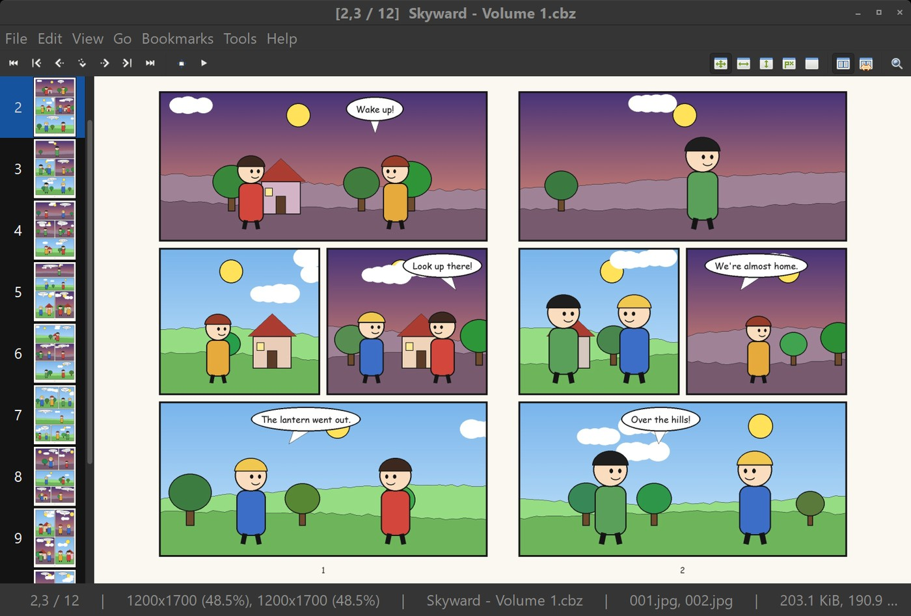
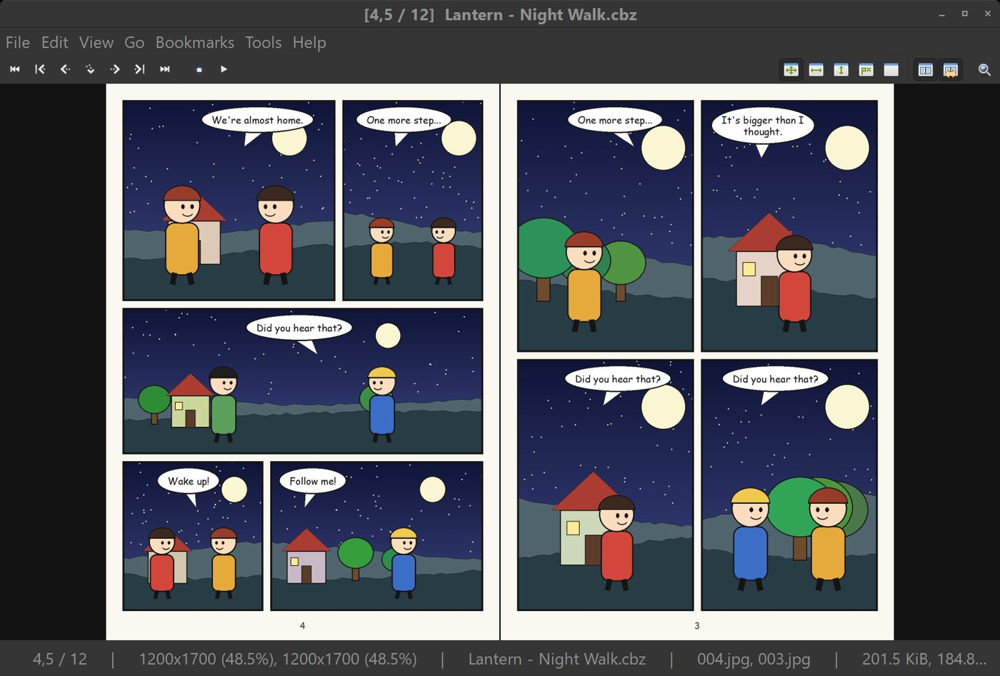
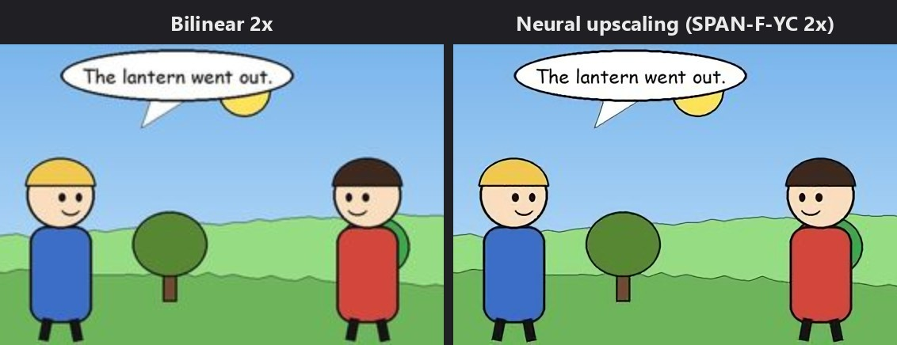
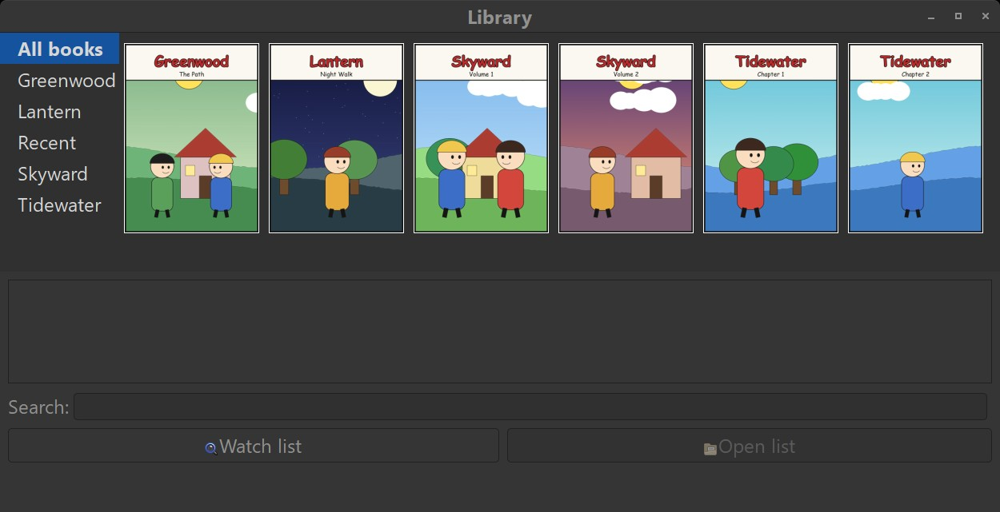

# MComix user guide

- [Installation](installation.md)
- [Keyboard and mouse](keyboard-and-mouse.md)
- [Preferences](preferences.md)
- [External commands](external-commands.md)

## Opening books

Open an archive, a PDF, an image or a folder with **File > Open** (Ctrl+O), by
dragging it onto the window, or from the command line. MComix shows the images
in it as pages, and can go on to the next archive or folder beside it
(Ctrl+Shift+N, Ctrl+N, or automatically at the end, see
[Preferences](preferences.md#behaviour)).

Archives: ZIP/CBZ, TAR/CBT (also gzip, bzip2 and xz compressed), 7z/CB7,
RAR/CBR, LHA, PDF and MobiPocket/AZW3 e-books (their pictures), including
archives inside archives. A `.mobi` file opens when you open it directly; only
`.azw3` files are found by the file chooser's archive filter, next/previous
archive and the library. Some formats need an
extra tool: see [Installation](installation.md#optional-tools). Images: JPEG,
PNG, GIF, WebP (including animated), AVIF, SVG, BMP, TIFF and the other formats
GdkPixbuf and Pillow read.

Pages of ZIP, uncompressed TAR and non-solid RAR/7z archives are read on
demand, so a large book opens at once without being extracted first.

When you reopen a book, MComix offers to resume at the page where you stopped.



## Reading

### Fit modes

- **Best fit** (B): the whole page fits in the window.
- **Fit width** (W): the page fits the window's width and scrolls vertically.
- **Fit height** (H): the page fits the window's height and scrolls
  sideways.
- **Fit to size** (S): fixed sizes set in
  [Preferences > Display](preferences.md#display), separately for wide pages.
- **Manual zoom** (A): zoom freely with + and −, or Ctrl+wheel.

Fit modes only shrink pages. **View > Stretch small images** (Y) also enlarges
small ones; [neural upscaling](#neural-upscaling) can do that with a neural
network instead of plain resizing.

For an uncluttered view, press F for fullscreen, or I to hide every interface
element.

### Double page and manga mode

**Double page mode** (D) shows two pages side by side, like an open book. By
default the first page (the cover) and wide pages, such as double-page
spreads, are shown alone. Page Down then moves two pages.

If a book is missing a page, the pairs come out wrong. **View > Shift pairing
forward / back** (Ctrl+Page Down / Ctrl+Page Up) moves by one page to fix
them.

**Manga mode** (M) lays out pages right to left, and turns the reading and
scrolling direction around to match.



### Smart scrolling and slideshow

Space scrolls the page in reading order, sideways across the page before going
down, and turns the page at its end. **Use smart scrolling** (Preferences >
Behaviour) makes the mouse wheel do the same. A slideshow (Ctrl+S) scrolls and
turns pages by itself.

### Bookmarks, magnifier and more

- **Bookmarks** (Ctrl+D to add, Ctrl+B to edit) remember a book and a page.
- The **magnifying lens** (L, or hold the middle mouse button) zooms into the
  area under the pointer.
- **Tools > Enhance image** (E) adjusts brightness, contrast, saturation and
  sharpness, or inverts colours, with a histogram.
- **Edit > Copy** copies the page image and its path.
- **File > Save As** extracts the current page.
- **Edit > Edit archive** reorders, adds and removes pages, edits comments
  and saves a new archive.

## Neural upscaling

On Windows, MComix can enlarge small pages with a neural network instead of
plain resizing, which keeps lines and text sharp. Turn it on in
**Preferences > Display > Image quality > Neural upscaling for small pages**.



- It needs a DirectX 12 GPU, and never runs on the CPU. Without a usable GPU,
  pages are drawn as before.
- It applies to static pages smaller than the size set there that are shown
  larger than their own size. Animations and pages with transparency are never
  upscaled; grayscale pages stay grayscale.
- The bundled model is SPAN-F-YC, 2x, trained for this fork (see
  [the model notes](../../mcomix/upscale_models/README.md)). You can select
  another ONNX model converted with `tools/export_onnx.py`.
- **GPU runtime: Automatic** uses NVIDIA TensorRT-RTX through Windows ML when
  it is installed (Windows 11 24H2 or later; Preferences offers to install it),
  and DirectML otherwise. The first page on TensorRT-RTX takes a while, as the
  engine is built once and then kept in `%APPDATA%\MComix`.
- Pages appear at once, resized the usual way, and are redrawn when the
  upscaled result is ready.

### Benchmark

Quality on 100 comic pages the model was not trained on (81 grayscale, 19
colour, from 86 books): each page, its longest edge capped at 3,000 pixels
(median 1,416 × 2,000), was halved with bicubic resampling and enlarged 2x
again. PSNR and SSIM compare the result with that capped page, on brightness
(Y) with a 2-pixel border left out; higher is better. The JPEG rows save the
halved page as JPEG quality 75 first, as real scans often are. The model ran
on DirectML for these scores.

| Input | Bilinear | Lanczos | SPAN-F-YC 2x |
| --- | --- | --- | --- |
| Clean, PSNR-Y | 23.33 dB | 24.95 dB | **30.70 dB** |
| Clean, SSIM-Y | 0.799 | 0.838 | **0.932** |
| JPEG, PSNR-Y | 23.12 dB | 24.48 dB | **28.02 dB** |
| JPEG, SSIM-Y | 0.783 | 0.811 | **0.881** |

SPAN-F-YC scores higher than Lanczos on 99 of the 100 clean pages and 98 of
the JPEG ones.

Cost per page, on 30 of those pages (input median 0.7 megapixels, at most
1.6; 21 different sizes), each method in its own process, enlarging each page
exactly 2x. The model times include what MComix does with the result: the
grayscale check and the conversion for display. At any other display size,
MComix also resizes the 2x result with Lanczos, which these times leave out.
MComix shows the page resized the usual way first, so the model's time is
added in the background.

| | Bilinear | Lanczos | SPAN-F-YC, DirectML | SPAN-F-YC, TensorRT-RTX |
| --- | --- | --- | --- | --- |
| Page of a new size (first page of each of the 21 sizes), median (90th percentile) | 9 ms (20) | 32 ms (76) | 61 ms (135) | 199 ms (236) |
| Page of a size already seen (3 repeats of each page), median (90th percentile) | 9 ms (20) | 32 ms (77) | 59 ms (132) | 22 ms (57) |
| Model load, then first page | – | – | 0.34 s, 0.23 s | 1.2 s, 0.26 s |
| Peak RAM added | 17 MiB | 68 MiB | 327 MiB | 533 MiB |
| GPU memory | – | – | 970 MiB | 740 MiB |

The pages of a book usually share a size, so most pages cost the second row.
GPU memory was read after the timed pages. The very first TensorRT-RTX use
also builds its engine, once: 12.8 s to load and 2.3 s for the first page;
after that, each new page size costs the first row. Measured on an
NVIDIA GeForce RTX 5090, Intel Core i7-13700K and Windows 11, with ONNX
Runtime 1.30 (Windows ML), Pillow 13.0 and GdkPixbuf 2.44, at commit
`c13ede80`; a slower GPU takes longer. Pages from other sources, such as scans
already blurred or noisy, will score differently.

## Animated WebP

Animated WebP pages play from files and archives with their own frame timing
and loop count, in every zoom mode, rotated or flipped, and side by side in
double page mode. Preferences > Advanced > Animated images can turn playback
off, limit the display size and set the memory shared by animations.

## The library

The library (Ctrl+L) shows the covers of your archives, grouped in
collections. A book in the library is one archive file; folders of images
aren't added.



- Right-click the collection list to add a collection; drag one collection
  onto another to nest it. **All books** holds every book, and a collection
  shows the books of its subcollections too.
- Right-click a collection or the book area to add books. The book area's menu
  also opens and removes books and sets the cover size and sort order.
- **Watch list:** MComix scans the folders you list here, when you click
  **Scan now** or, if that option is on in the watch list, each time the
  library opens. It adds the new archives it finds, optionally to a chosen
  collection.
- With recent files on (Preferences > Behaviour), books you open are added to
  the **Recent** collection.
- A badge marks the books you have finished.

## Command line

```
mcomix [options] [path]
```

| Option | Effect |
| --- | --- |
| `-e NAME`, `--entry NAME` | open the book at the page with this name inside the archive (folders separated by `/`), or at this file in the folder |
| `-p N`, `--page N` | open the book at page N, when `--entry` isn't given or names no page |
| `-f`, `--fullscreen` | start in fullscreen |
| `-m`, `--manga` | start in manga mode |
| `-d`, `--double-page` | start in double page mode |
| `-b`, `-w`, `-h` | start in best fit, fit width or fit height mode |
| `-s`, `--slideshow` | start a slideshow |
| `-l`, `--library` | show the library |
| `--lang CODE` | use this interface language once |
| `-W LEVEL` | log level: `all`, `debug`, `info`, `warn` or `error` |
| `-v`, `--version`, `--help` | print the version or the options |

`--entry` and `--page` open the book without asking to resume, so another
program, such as a manga manager, can open a book at a chosen page. On Windows,
run `MComix.exe` from the portable folder, or `start.bat` from a source
checkout.
